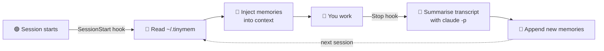

<div align="center">

# 🧠 tinymem

### Tiny persistent memory for Claude Code

*Claude forgets everything when a session ends. tinymem gives it back.*

[](LICENSE)
[](https://nodejs.org)
[](https://claude.com/claude-code)
[](package.json)
[](#)
[](#)
[](CONTRIBUTING.md)

</div>

---

## 😤 The problem

You spend an hour teaching Claude your project. The build quirk. The thing that
looks like a bug but isn't. That you run the deploys yourself.

Then you close the session, and all of it is gone.

## ✨ The fix

tinymem writes that knowledge down and hands it back the next time you open the
project:

```text
# tinymem — what you learned in earlier sessions here

- [fix] Vercel serves repo root statically; front end moved to public/   (2026-08-07)
- [fix] api/[...path].js catch-all 404s on nested routes; fixed in 308ce39
- [state] Deploys hang in UNKNOWN; DATABASE_URL still unset
- [preference] User runs logins; assistant does not handle credentials
```

That block is injected at the top of every new session in that project.

🔒 **No server. No database. No account. Nothing phones home.** Your memories are
plain JSONL files on your own disk, in `~/.tinymem/`.

---

## 🚀 Install

> **Requires** [Claude Code](https://claude.com/claude-code) and Node 18+.

```bash
claude plugin marketplace add varun642002/tinymem
```

```bash
claude plugin install tinymem@tinymem
```

Open a new session. That's it. 🎉

<details>
<summary>📦 Other ways to install</summary>

**Try it for one session, no install:**

```bash
claude --plugin-dir /path/to/tinymem
```

**Without the plugin system** — clone it, then add to `~/.claude/settings.json`,
replacing `/path/to/tinymem` with where you put it:

```json
{
  "hooks": {
    "SessionStart": [{ "matcher": "startup|resume|clear|compact", "hooks": [{ "type": "command", "command": "node \"/path/to/tinymem/hooks/session-start.mjs\"", "timeout": 15 }] }],
    "Stop": [{ "hooks": [{ "type": "command", "command": "node \"/path/to/tinymem/hooks/stop-capture.mjs\"", "timeout": 120 }] }]
  }
}
```

**Update later:**

```bash
claude plugin marketplace update tinymem
```

**Uninstall:**

```bash
claude plugin uninstall tinymem@tinymem
```

Your memories survive uninstall — delete `~/.tinymem/` if you want them gone too.

</details>

---

## ⚙️ How it works

Memory is three moving parts. That really is the whole idea:



| | Part | File | What it does |
|---|---|---|---|
| 💾 | **Store** | `lib/store.mjs` | One JSONL file per project under `~/.tinymem/` |
| 📖 | **Recall** | `hooks/session-start.mjs` | `SessionStart` hook injects past memories |
| 🤖 | **Capture** | `hooks/stop-capture.mjs` | `Stop` hook summarises the finished session |
| 📥 | **Import** | `lib/import.mjs` | Backfills from transcripts you already have |

A hook can't think, so capture shells out to `claude -p` with a cheap model,
hands it the transcript, and asks for 0–5 durable facts as JSON. Titles of
existing memories go into that prompt, so it won't store the same thing twice.

💰 **Cost:** roughly a cent per session on Haiku.

### 🏷️ What gets remembered

| Type | Meaning | Example |
|---|---|---|
| `decision` | A choice and its reason | *Chose Postgres over SQLite for concurrent writes* |
| `fix` | A gotcha and its resolution | *Catch-all route 404s on nested paths; use an explicit rewrite* |
| `preference` | How you want to be worked with | *User runs logins; assistant never handles credentials* |
| `fact` | A non-obvious constraint | *Build is esbuild; the webpack config is dead* |
| `state` | Where ongoing work stands | *Deploys hang in UNKNOWN; DATABASE_URL unset* |

It is told **not** to record file-by-file narration, anything obvious from the
code or git history, routine tool output, or secrets.

---

## 🎮 Commands

| Command | What it does |
|---|---|
| 💾 `/remember <thing>` | Save a memory now. Leave blank and Claude picks from the conversation. |
| 🔍 `/recall <terms>` | Search this project's memory. |
| 📥 `/memory-import` | Backfill from sessions you already had. |

<details>
<summary>⌨️ Using the CLI directly</summary>

```bash
node lib/cli.mjs list              # most recent memories here
```

```bash
node lib/cli.mjs search webpack    # keyword search
```

```bash
node lib/cli.mjs add "Deploys need VPN" --type fact --title "VPN for deploys"
```

```bash
node lib/cli.mjs forget <id>       # drop one
```

```bash
node lib/cli.mjs projects          # every project with memories
```

```bash
node lib/cli.mjs where             # path to this project's store file
```

</details>

---

## 📥 Import your history

Already used Claude Code for months? Don't start from nothing.

**Look before you leap** — this is free and takes seconds, even over gigabytes:

```bash
node lib/import.mjs --dry-run
```

Then import for real:

```bash
node lib/import.mjs
```

Or narrow it down:

```bash
node lib/import.mjs --project my-app --limit 5
```

✅ **Resumable** — sessions already imported are skipped, so stop and re-run freely.
✅ **Memory-safe** — transcripts are streamed line by line. A 240 MB session file
costs no more RAM than a small one.
✅ **Fast** — 1.1 GB across 26 sessions scanned in about 7 seconds.

It skips subagent and workflow transcripts, keeping only real conversations.

---

## 🔧 Configuration

All optional, all environment variables:

| Variable | Default | Effect |
|---|---|---|
| `TINYMEM_AUTOCAPTURE` | on | Set `0` to stop auto-capture; `/remember` still works |
| `TINYMEM_MODEL` | `claude-haiku-5-5` | Model used to summarise |
| `TINYMEM_RECALL_LIMIT` | `25` | How many memories to inject at session start |
| `TINYMEM_HOME` | `~/.tinymem` | Where memories are stored |
| `TINYMEM_PROJECTS` | `~/.claude/projects` | Where the importer looks for transcripts |
| `TINYMEM_DEBUG` | off | Set `1` to print what the summariser returned, and why it failed |

---

## 🛟 Troubleshooting

<details>
<summary>❓ No memory block appears at session start</summary>

Memories are per project, and a brand new project has none until its first
session ends. Check whether anything is stored:

```bash
node lib/cli.mjs list
```

Hooks also load at startup — a session already open when you installed won't
have them. Open a new one.

</details>

<details>
<summary>❓ Nothing is being captured</summary>

Run with debugging on to see what the summariser actually said:

```bash
TINYMEM_DEBUG=1 node hooks/stop-capture.mjs < payload.json
```

Common causes: `claude` is not on `PATH` for the hook's environment, the session
was shorter than four turns (deliberately skipped), or everything in it was
already known.

</details>

<details>
<summary>❓ It stored something wrong</summary>

```bash
node lib/cli.mjs list      # find the id
```

```bash
node lib/cli.mjs forget <id>
```

The store is plain JSONL — editing it in a text editor is entirely fine.

</details>

<details>
<summary>❓ I don't want it summarising a sensitive project</summary>

```bash
TINYMEM_AUTOCAPTURE=0 claude
```

Recall keeps working; only capture stops. Set it in that project's environment
to make it permanent.

</details>

---

## ⚠️ Things worth knowing

> [!IMPORTANT]
> **Memories are data, not instructions.** The injected block says so explicitly,
> because anything that reaches a transcript can reach memory. If you edit the
> prompts, keep that framing — it's what stops a stray line in some log from
> becoming a standing instruction.

> [!WARNING]
> **Nothing is encrypted.** The extractor is told to skip secrets, but it is a
> model, not a guarantee. Don't point this at a repo whose transcripts carry
> credentials.

> [!NOTE]
> **Memory never blocks you.** Every failure in the capture path is swallowed.
> The worst case is a session that stores nothing — never a session you can't end.

**It won't recurse.** The summariser is itself a Claude session, so it would
otherwise fire the same `Stop` hook forever. Two guards prevent that: the child
runs with `TINYMEM_CHILD=1`, and `stop_hook_active` is honoured.

---

## 🧭 Notes for anyone forking this

Four things cost real debugging time, in case you hit them too:

| 🐛 | Trap | Why it bites |
|---|---|---|
| 1 | **Windows path spellings** | `C:\Foo` and `c:/foo/` must hash to the same project, or the hook and the CLI silently write to different files. |
| 2 | **Node won't spawn `.cmd`** | On Windows the `claude` call must go through the shell as one command string. Passing an args array with `shell: true` is deprecated. |
| 3 | **`--bare` can't use OAuth** | It's the right flag for a cheap child run, but authenticates *only* via `ANTHROPIC_API_KEY`. On a subscription login it fails outright, so tinymem adds it only when that key exists. |
| 4 | **Transcript folder names lie** | Sessions get relocated, so the real working directory must be read from the `cwd` field inside the entries, not the directory name. |

---

## 🗺️ Roadmap

Ideas worth building, roughly in order of value. PRs very welcome:

- [ ] 🔎 **Better search** — embeddings (`@xenova/transformers` runs locally) or SQLite FTS5
- [ ] 🍂 **Decay and merge** — re-summarise periodically, drop what's contradicted
- [ ] 🌍 **Global vs project scope** — your preferences follow you; project facts don't
- [ ] 🔌 **An MCP server** — so Claude can query memory mid-session, not just at the top
- [ ] ✂️ **A `PreCompact` hook** — capture before compaction so long sessions don't lose their middle
- [ ] 📊 **`/memory-stats`** — what's stored, where, and how stale
- [ ] 🧪 **A real test suite** — currently verified by hand

---

## 🤝 Contributing

Issues and pull requests are welcome — see [CONTRIBUTING.md](CONTRIBUTING.md).
The codebase is deliberately small and dependency-free; please keep it that way.

## 📄 License

[MIT](LICENSE) — do whatever you like with it.

<div align="center">

**If this saved you from explaining your project to Claude for the fifth time, ⭐ it.**

</div>
